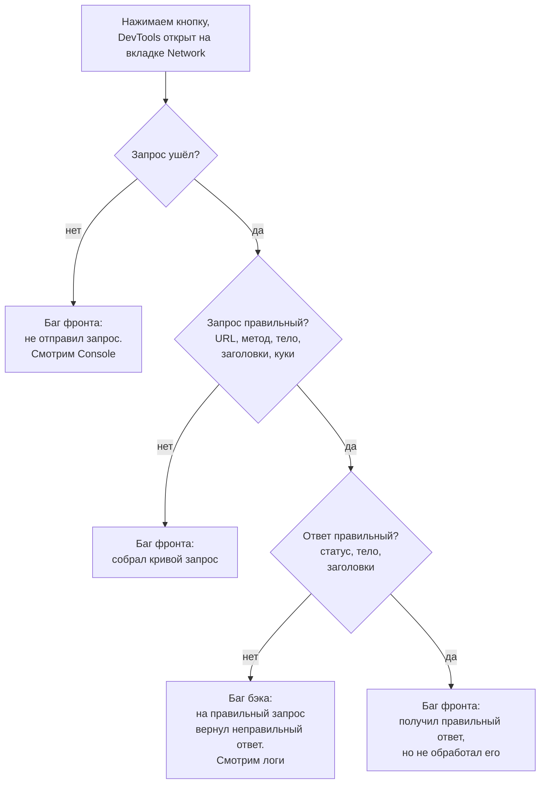

# 5.1 · Кнопка не работает: фронт или бэк?

Встречается почти везде · тема: DevTools, локализация дефекта · сложность: легкая

## Условие

Обертки бывают разные, суть одна:

> На сайте есть кнопка. По нажатию должен появиться текст (скачаться картинка, открыться страница). Ничего не происходит. Что будешь делать?

<b>Решение</b>

Здесь ждут алгоритм: что проверяешь и какой вывод делаешь на каждом шаге. В итоге надо понять, чей баг, фронтенда или бэкенда.

Сразу скажи, что сверяешься с документацией (Swagger, требования, тест-кейсы): куда должен уходить запрос, с каким телом и какой должен прийти ответ.

**Шаг 1. Ушел ли запрос.** Открываем DevTools → Network и повторяем действие. Запроса нет - фронтенд не обратился к серверу, баг на фронте. Во вкладке Console при этом часто видна JS-ошибка.

**Шаг 2. Правильный ли запрос.** Сверяем с документацией по порядку: адрес, HTTP-метод, тело (вкладка Payload), заголовки, куки и авторизацию. Запрос собирает фронтенд, поэтому ошибка в любом из этих пунктов - баг фронта.

**Шаг 3. Правильный ли ответ.** Смотрим статус-код, тело (поля и значения), заголовки, `Set-Cookie`. Если на правильный запрос пришел неправильный ответ, баг на бэке. Дальше ищем причину в логах сервиса, а если есть доступ к коду, то и в нем.

**Шаг 4. Запрос и ответ правильные, а на странице пусто.** Фронтенд не обработал корректный ответ, снова баг фронта.

**Частая ошибка - решать по одному статус-коду.** Рассуждение "пришел `4xx`, это ошибка клиента, значит, виноват фронт" неверно. `404` придет и на правильный адрес, если бэкенд не нашел существующую сущность или на бэке поменяли маршрут. Статус-код подсказывает, где искать, а вывод делаешь, только когда сверил сам запрос.

