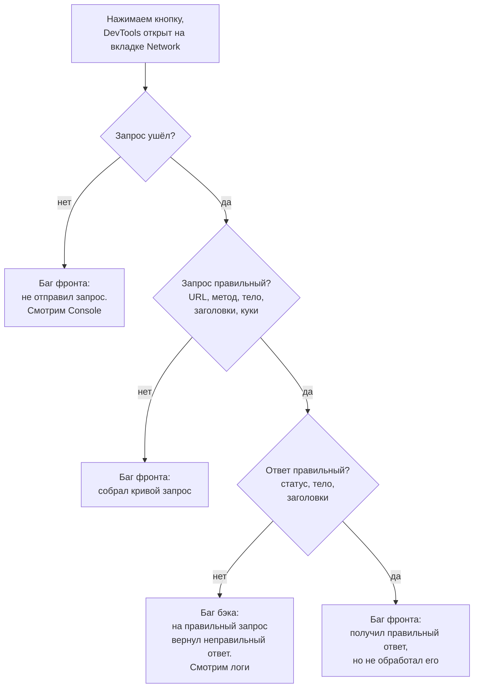

# 5.1 · Кнопка не работает: фронт или бэк?

🟢 разминка · тема: DevTools, локализация дефекта · встречается почти везде

## Условие

Задача приходит в разных обёртках, но суть одна:

> На сайте есть кнопка. По нажатию должен появиться текст (скачаться картинка, открыться страница). Ничего не происходит. Что будешь делать?

<b>Решение</b>

От тебя ждут не угаданную причину, а алгоритм: что проверяешь и какой вывод делаешь на каждом шаге. Итог алгоритма — понять, на чьей стороне баг: фронтенда или бэкенда.

Перед началом стоит сказать, что сверяться будешь с документацией (Swagger, требования, тест-кейсы): куда должен уходить запрос, с каким телом и какой должен прийти ответ.

**Шаг 1. Ушёл ли запрос.** Открываем DevTools → Network и повторяем действие. Если запроса нет, фронтенд даже не попытался обратиться к серверу, значит, баг на фронте. Дальше можно заглянуть во вкладку Console: там часто видна JS-ошибка.

**Шаг 2. Правильный ли запрос.** Сверяем с документацией по порядку: адрес, HTTP-метод, тело (вкладка Payload), заголовки, куки и авторизацию. Запрос формирует фронтенд, поэтому ошибка в любом из этих пунктов означает баг фронта.

**Шаг 3. Правильный ли ответ.** Запрос правильный, смотрим ответ: статус-код, тело (поля и их значения), заголовки, `Set-Cookie`. Если на правильный запрос пришёл неправильный ответ, баг на бэке. Дальше локализуем внутри бэкенда по логам сервиса, а если есть доступ к коду, то и по нему.

**Шаг 4. Всё правильно, но на странице пусто.** Запрос правильный, ответ правильный, а кнопка не сработала. Значит, фронтенд не смог обработать корректный ответ: снова баг фронта.

**Частая ошибка: решать по одному статус-коду.** «Пришёл `4xx`, значит, ошибка клиента, значит, виноват фронт» — так рассуждать нельзя. `404` может прийти на правильный адрес, если бэкенд не нашёл существующую сущность или на бэке поменяли маршрут. Статус-код подсказывает, где искать, но ответа не даёт. Решение принимаешь, только когда сверил сам запрос.

